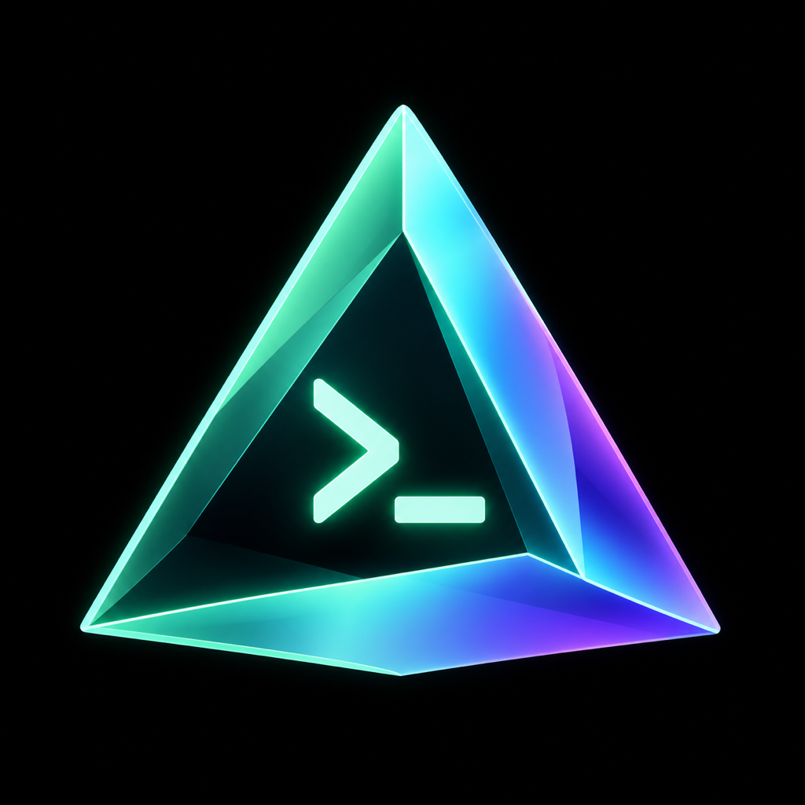

# Prism Terminal

### Your Mac, one spoken command away.

Prism Terminal is an iPhone and Meta Ray-Ban front end for Codex on your Mac. Dictate a request, review the text, and press **Send**. Everyday commands take a direct native path; bigger tasks go to a persistent Codex session.

**Previously Codex Lens, now Prism Terminal.** This is a developer beta in controlled real-world testing—not a finished, always-on consumer assistant. The reliable core is explicit dictation and Send. Background voice and continuous camera-aware interaction still need work.

Build 25 adds idle-worker recovery after a Mac login change and opens directly at recent messages instead of replaying the entire conversation on screen. Recovery never automatically repeats a failed command. See [build 25 notes](docs/BUILD25.md).



## What you can do

| Ask | Route |
| --- | --- |
| “Open the Calculator app” / “Go to Chrome” / “Focus Notes” | Exact allowlisted app command; no model turn |
| “Type: hello from Prism” | Insert into the focused editable field; no Enter or Send |
| “Close this window” / “Move this window left” | Bounded current-window action |
| “Open a new tab” / “Search the web for…” | Direct browser/search command |
| Ask Codex to inspect code, investigate a problem, or perform a larger computer task | Persistent Mac-side Codex session and available tools |
| Attach a requested camera image and ask about it | Image context for the task; readability depends on the scene |

Dictation keeps completed phrases while subsequent speech is recognized. Commands have durable receipt IDs: an interrupted connection must not silently run the same action twice. The composer clears only the submitted revision, so an older response cannot erase newer text.

The direct shortcuts apply to standalone commands without explicitly attached images. Image-attached requests intentionally use the contextual Codex route. Complex computer control depends on the supported computer/browser tools available in your Codex installation and macOS permissions. A model acknowledgement is not proof that a task completed.

## How it fits together

```text
iPhone / glasses → dictation or typed request → explicit Send
                                               │
                         ┌─────────────────────┴────────────────────┐
                         │                                          │
                  Exact everyday command                    Contextual task
                         │                                          │
                  Native Mac executor                    Persistent Codex session
                         └─────────────────────┬────────────────────┘
                                               │
                                      Result / durable receipt
```

The phone connects to your Mac gateway over private HTTPS. The Mac must remain awake and online. This is a long-running Codex agent connection, not a raw SSH/tmux terminal or an unlimited background-execution guarantee.

## Start on the Mac

You need macOS, **Node.js 26**, a working authenticated Codex installation, and Xcode for building the phone app. Codex account limits apply. Native controls need appropriate Accessibility/Automation permissions; more general computer use requires compatible Codex computer/browser tooling. Those tools and Codex itself are not bundled here.

```sh
git clone https://github.com/rickndanger-ctrl/prism-terminal.git
cd prism-terminal
npm ci
npm run build
```

Create your own pairing token in the current shell. The next command copies it to your Mac clipboard so you can place it in the app's secure gateway-token field; do not paste it into an issue, source file, or chat.

```sh
export CODEX_LENS_GATEWAY_TOKEN="$(openssl rand -hex 32)"
printf '%s' "$CODEX_LENS_GATEWAY_TOKEN" | pbcopy
./scripts/run-gateway.zsh
```

The gateway binds to `127.0.0.1:8787`. `GET /v1/health` is a liveness check; it does not prove your Codex account, Mac permissions, or phone connection is ready. Keep the same pairing token for subsequent starts using your own secret manager or Keychain. The start script can read the `com.codex-lens.gateway.token` generic-password item under the `codex-lens` account; it never includes a default secret.

An OpenAI API key is **not required for the core Codex terminal path**. Optional API-based voice/reasoning features use your own credentials and may incur separate usage. Local speech and CLEF integrations are opt-in, not prerequisites for exact everyday commands. See [gateway setup](packages/gateway/README.md) and [local speech](local-voice/README.md).

## Connect the phone privately

Use your own authenticated private HTTPS connection to the loopback gateway. One option is Tailscale on both devices with **Serve**, not public Funnel:

```sh
tailscale serve --bg http://127.0.0.1:8787
```

Use the HTTPS URL printed by Tailscale in Prism's connection settings. Serve shares the service within your tailnet; review access controls and follow the [official Serve instructions](https://tailscale.com/docs/reference/tailscale-cli/serve). Do not expose this Mac-control gateway through a public port or unauthenticated tunnel.

## Build the iPhone app

```sh
open samples/CameraAccess/CameraAccess.xcodeproj
```

1. Select the **CameraAccess** scheme. That inherited project name builds **Prism Terminal**.
2. Choose your own signing team and unique bundle identifier. Public source intentionally contains no developer signing identity or provisioning profile.
3. Review the app's Meta configuration and SDK developer requirements. For glasses, use supported hardware and your own Meta developer setup. See [third-party notices](THIRD_PARTY_NOTICES.md).
4. Build and run on your iPhone. Grant microphone/speech permissions for dictation and camera/Bluetooth permissions only for features you intend to use.
5. Enter your private HTTPS gateway URL and pairing token in the app's settings.

Core Prism does not require a private `Secrets.swift`. The public project compiles with empty defaults for inherited optional integrations. It does not ship the original developer's API keys, local addresses, accounts, or signed application. See the [iOS build guide](samples/CameraAccess/README.md).

First test: dictate **“Open the Calculator app”**, stop dictation, and tap **Send**. Confirm the actual app opens on the Mac. More checks and remaining limitations are in [real-world testing](docs/REAL-WORLD-TESTING.md).

## Validate the source

```sh
npm run typecheck
npm run lint
npm test
npm run test:scripts
swift test --package-path packages/CodexLensKit
```

The build-24 shared Swift baseline passed **410 tests**. Public packaging has its own verification record in [publication checks](docs/PUBLICATION-CHECKS.md). Unit tests are not evidence of locked-phone endurance, camera clarity, or delivery of a real message.

## Current limits

- Background hands-free voice is experimental. Explicit dictation and Send remain the recommended interaction.
- Long locked-phone sessions, reconnects under poor networks, and battery/thermal endurance are still being tested.
- Camera snapshots can provide useful context, but small text, glare, distance, and movement affect readability. Continuous live assistance is not certified reliable.
- Generic Codex tasks can be slower than exact shortcuts. No universal latency or token-savings claim is made.
- Legacy/provider/productivity adapters in the gateway are not all exposed or accepted in the current phone workflow. Their presence is not a promise of working email, messaging, or calendar automation.

## Repository layout

```text
samples/CameraAccess/      Native iOS application and Xcode project
packages/CodexLensKit/     Shared Swift models, dictation state, command parsing, tests
packages/gateway/         Mac gateway, native routes, persistent Codex transport
packages/shared/          Shared TypeScript domain models
native/                   macOS helper source; built locally
local-voice/              Optional local speech worker source; no weights bundled
scripts/                  Build, startup, diagnostics, and optional adapters
third_party/              Preserved upstream license and attribution files
```

## Safety and provenance

Read [SECURITY.md](SECURITY.md) before connecting a Mac with sensitive data. The Codex task worker can run with broad Mac access; task-scoping instructions are not an OS sandbox. Keep the token private, review permissions, and verify consequential outcomes.

The iOS foundation derives from VisionClaw and Meta's Wearables DAT sample code; SDKs and dependencies retain their own terms. Original notices are preserved in [THIRD_PARTY_NOTICES.md](THIRD_PARTY_NOTICES.md). Public visibility does not grant a blanket license over third-party components. Prism is not an official OpenAI or Meta product.
